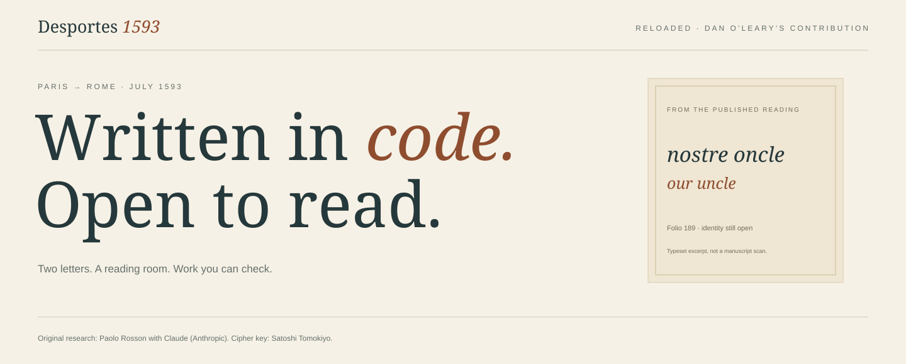
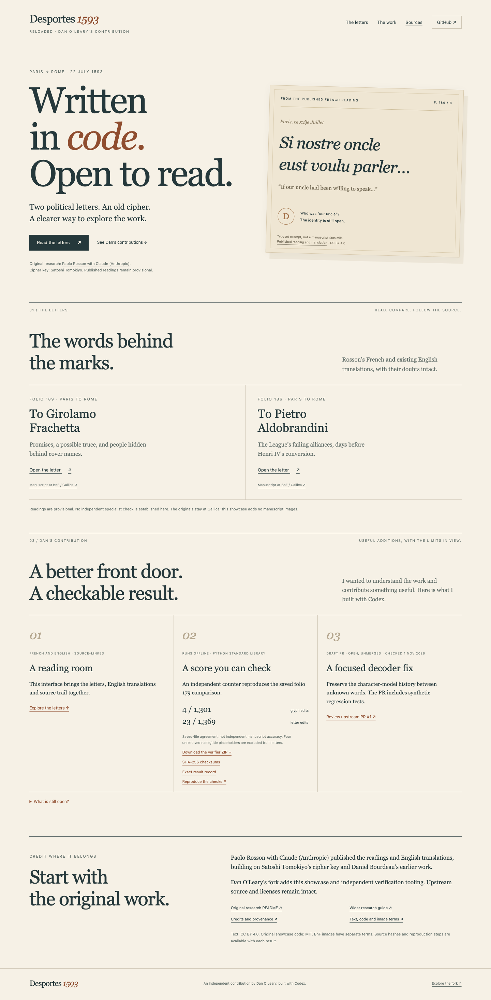
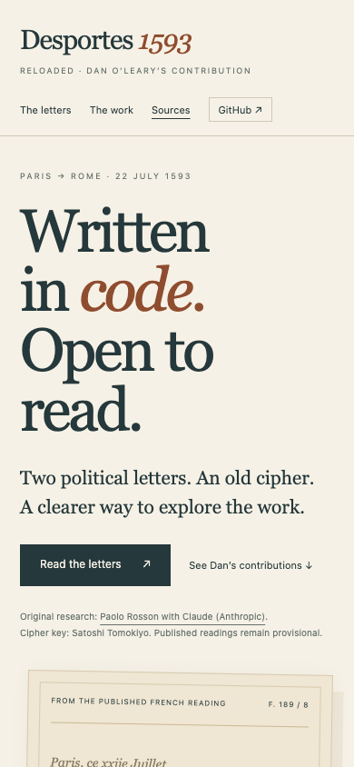

[](#open-the-showcase)

# Desportes 1593, Reloaded

**Dan O’Leary’s contribution:** a reading room, an offline score verifier, and a
focused decoder fix proposed upstream. Built with Codex.

The original research, readings, and English translations are by **Paolo Rosson
with Claude (Anthropic)**, using **Satoshi Tomokiyo’s cipher key** and building on
Daniel Bourdeau’s earlier work. [Original research README](README_UPSTREAM.md).

## Open the showcase

[Download the fork ZIP](https://github.com/danieloleary/desportes-1593/archive/refs/heads/main.zip), unzip it, and open **showcase/index.html**. The reader works offline. GitHub displays the HTML as source; no public web-hosted demo is configured.

For a local server, use Python 3.10 or later from the repository root:

```sh
python3 showcase/serve.py
```

Open **http://127.0.0.1:4193/showcase/**. Read either letter in English or French,
follow its source, and inspect what this fork adds. No install, account, model,
or network request is needed for the local reader. External source links need
internet access. You can also open `showcase/index.html` directly.

<details>
<summary>See the desktop and mobile interface</summary>





These captures show the actual interface. The typeset excerpt is not a manuscript scan.
</details>

## What this fork adds

| Contribution | Where to start | Status |
|---|---|---|
| Reading room and landing page | [Showcase source](showcase/) | Included in this fork |
| Independent saved-artifact scorer | [Run the verifier](contrib/saved-score/README.md) | Offline code and tests included |
| Decoder history fix and regressions | [Upstream PR #1](https://github.com/pangoleen/desportes-1593/pull/1) | Draft, open and unmerged as checked November 1, 2026 |
| Scope and remaining work | [Contribution ledger](CONTRIBUTIONS.md) | Separates software checks from manuscript evidence |

The draft PR is separate from this showcase branch. Original upstream code,
readings, labels, evidence, and image files remain unchanged.

## Check the saved scores

[Download the 13-file verifier ZIP](https://github.com/danieloleary/desportes-1593/raw/refs/heads/main/showcase/downloads/desportes-saved-verifier.zip) · [SHA-256 checksums](showcase/downloads/SHA256SUMS.txt) · [Exact result and reproduction](showcase/VERIFICATION.md).


The checker compares two public files for folio 179. It reproduces **4 edits /
1,301 glyphs** and **23 edits / 1,369 letters**. Four unresolved `#` name/title
placeholders are excluded from letter scoring.

Keep the preview in one terminal. Run these standard-library tests in another:

```sh
python3 -B -m unittest discover -s contrib/saved-score -p test_score_saved.py -v
```

Write a report to a fresh output filename:

```sh
python3 -I -B contrib/saved-score/score_saved.py \
  --gold contrib/saved-score/inputs/f179r.txt \
  --machine contrib/saved-score/inputs/f179r_machine_blind.txt \
  --manifest contrib/saved-score/manifest.json \
  --output /tmp/desportes-saved-report.json
```

An existing output is refused. [Method and limits](contrib/saved-score/METHOD.md).
With Node.js 18 or later, check source integrity and links:

```sh
node --test showcase/tests/source-integrity.test.cjs
python3 -I -B showcase/package_verifier.py --check
```

**Saved-file agreement is not independent manuscript accuracy.** The reference
was made with model assistance. These checks do not reproduce image recognition,
prove blinding, identify the remaining people, or establish a new decipherment.

## Find the research

- [French readings and published English translations](reading/).
- [Original accuracy report](evidence/accuracy.md), [labels](gold/), and [code](code/).
- [Original research README](README_UPSTREAM.md) and [wider research guide](https://github.com/pangoleen/cipher-readings/blob/main/GUIDE.md).
- [Contributing](CONTRIBUTING.md) and [credits and provenance](showcase/ATTRIBUTION.md).

These are Catholic League political letters from **1593**. Separate preliminary
Dead Sea Scroll glyph work has not deciphered Cryptic B and is not included here.

## Credits and terms

Upstream code: MIT. Readings, translations, labels, and reports: CC BY 4.0.
Original showcase and verifier code: MIT. The reader credits the existing English
translation rather than presenting it as new.

BnF / Gallica manuscript images have separate reuse terms. This showcase adds
**no manuscript images** and links to the originals. Upstream reduced crops stay
unchanged. The private Site, full scans, raw notes, access configuration, and
credentials are outside this candidate.

[Original licenses](LICENSE.md) · [Showcase credits](showcase/ATTRIBUTION.md) ·
[Verifier credits](contrib/saved-score/CREDITS.md).
